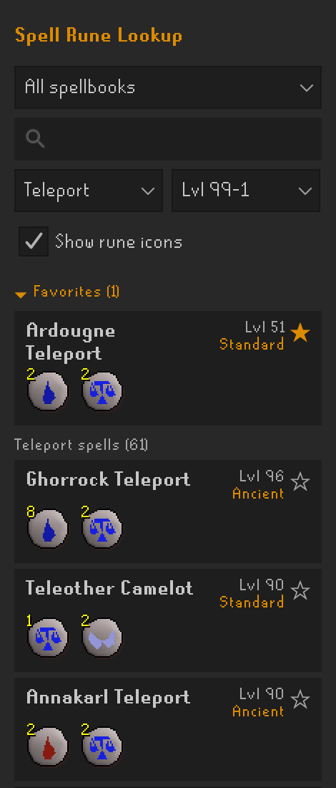

# Spell Rune Lookup

See which runes every spell needs without leaving the bank.

Spell Rune Lookup adds a side panel to RuneLite that lists every spell in all four spellbooks with its Magic level and rune cost. Check what to withdraw before you close the bank, instead of opening your spellbook to hover over each spell.

## Features

- **All four spellbooks:** Standard, Ancient Magicks, Lunar and Arceuus, plus an **All spellbooks** view for when you don't know which book a spell is in.
- **Rune icons or text:** see each spell's runes as in-game rune sprites with amounts, or as plain text.
- **Search:** find spells by name or by rune. Searching "astral" shows every spell that uses astral runes.
- **Favorites:** star up to 3 spells per spellbook to pin them to the top. The Favorites section can be collapsed.
- **Filter and sort:** show only Combat, Teleport or Utility spells, and sort by level (low to high or high to low) or by name.
- **Spells you can't cast yet:** once you're logged in, spells above your Magic level or locked behind a quest or diary you haven't finished can be shown, dimmed or hidden. Locked spells say what they need, for example "Needs Desert Treasure I".
- **Extra requirements:** shows staffs, items and unlocks a spell needs besides runes, such as Iban's staff or a banana for Ape Atoll Teleport.

## How to use

1. Click the teal wizard hat in RuneLite's sidebar.
2. Pick a spellbook, or **All spellbooks**.
3. Search, filter or sort to find the spell you want.
4. Click the star next to a spell to add it to your favorites.

## Settings

Open RuneLite's Configuration, search for **Spell Rune Lookup**, and click the gear.

| Setting | What it does |
| --- | --- |
| Show rune icons | Show runes as sprites with amounts (on) or as text (off). The same toggle is at the top of the panel. |
| Spells I can't cast yet | **Show**, **Dim** or **Hide** spells above your Magic level or locked by a quest or diary. Favorites are never hidden. |

Your favorites, filter and sort choices are remembered between sessions.

## Notes

- Quest, diary and level checks use your account's progress and only work while you're logged in.
- A few unlocks can't be detected by RuneLite, such as Bones to Peaches (Mage Training Arena) and Ourania Teleport (talking to Baba Yaga). These show a reminder instead.
- Spell names, rune costs and requirements come from the [Old School RuneScape Wiki](https://oldschool.runescape.wiki/).

## License

BSD 2-Clause. See [LICENSE](LICENSE).
